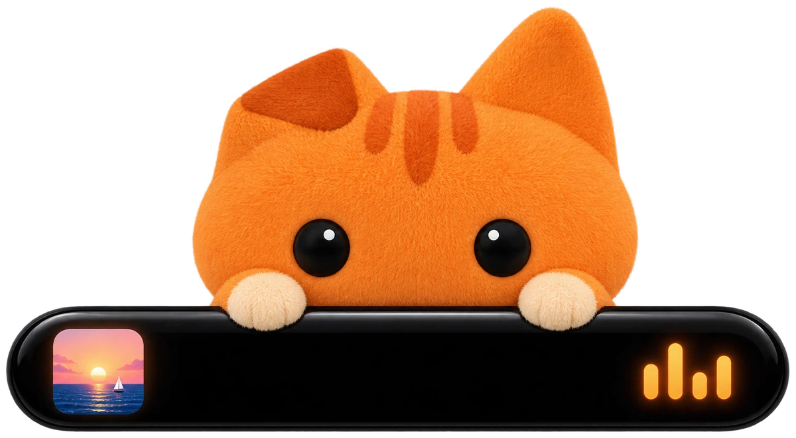

<h1 align="center">0 downloads</h1>

of Oyenza Studio for Windows, from GitHub Last 7 days: <b>0</b> · <b>0</b> stars on GitHub

## Per release

| Release | Published |  | Total |
| --- | --- |  | --: |
| **All releases** | |  | **0** |

## Per day

| Day | Downloads |
| --- | --: |

## On GitHub

0 stars · 0 forks · 0 watching

How we count

- GitHub counts every download of a release file. The Download button on the [website](https://studio.oyenza.com/) and in the README always fetches `Oyenza-Studio-Setup.exe` from the newest release; the versioned installer and the portable zip are on each release's page.
- GitHub updates its counters every few minutes, so for a while a counter may not show a CI download that is already taken off. Each file's number keeps its highest reading, so numbers only go up.
- Still in the numbers: our own check of each new release (one download through the Download button) and any bots. GitHub can't tell those apart.
- Oyenza Studio itself sends nothing: no accounts, no tracking. These are GitHub's download counters, read every hour.
- Page views and clones need a `METRICS_TOKEN` repository secret: a fine-grained token for this repository with Administration: Read-only. GitHub keeps them for 14 days only.

Updated 28 Oct 2026, 13:32 UTC by [Download stats](https://github.com/yuxueliyuxl/oyenza-studio/actions/workflows/metrics.yml), every hour · Data: [downloads](data/downloads.csv), [CI downloads](data/ci-downloads.csv), [stars](data/repo.csv), [summary.json](summary.json)
